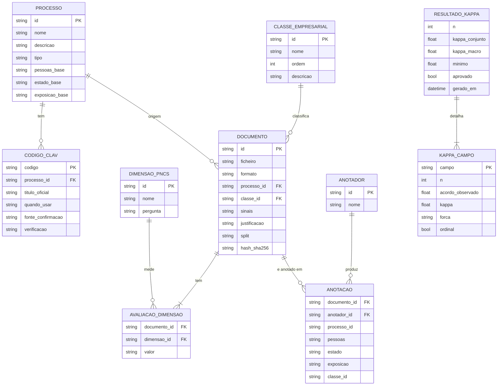
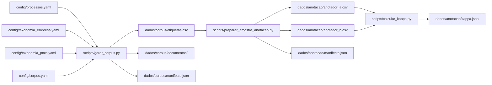

# Modelo de dados

Aqui fica a descrição dos dados do ContextIQ: que entidades existem, em que ficheiros estão, que campos têm, que valores aceitam e como se ligam umas às outras. A ideia é ter uma referência para saber o que cada passo do pipeline produz e o que o classificador vai poder consumir mais à frente.

Os dados dividem-se em dois grupos:

- os dados de referência, que estão em `config/*.yaml` (processos, taxonomias e parâmetros) e funcionam como fonte de verdade das regras;
- os dados gerados, que aparecem em `dados/` (corpus, amostras e resultados). Estes não ficam no Git e podem ser recriados a partir da configuração.

## Diagrama entidade-relação

O diagrama é conceptual, porque nem tudo existe como tabela separada. No `etiquetas.csv`, `DOCUMENTO` e `AVALIACAO_DIMENSAO` estão na mesma linha; as `ANOTACAO` estão espalhadas pelas folhas de cada anotador; e `RESULTADO_KAPPA`/`KAPPA_CAMPO` ficam no `kappa.json`. As entidades de referência (`PROCESSO`, `CLASSE_EMPRESARIAL`, `DIMENSAO_PNCS` e `CODIGO_CLAV`) vêm dos YAML.

## Entidades de referência (`config/`)

### PROCESSO (`config/processos.yaml`)

Cada processo de negócio é uma entrada deste ficheiro. É a primeira decisão da classificação: só depois de saber o processo é que faz sentido avaliar as dimensões e a classe.

| Campo | Tipo | Obrigatório | Descrição |
| --- | --- | --- | --- |
| `id` | string | sim | Identificador estável usado como chave em todo o projeto. |
| `nome` | string | sim | Nome legível do processo. |
| `tipo` | string | não | `fallback` apenas para o processo `outro`. |
| `descricao` | string | sim | O que o processo abrange. |
| `documentos_exemplo` | lista[string] | sim | Exemplos usados na geração e na anotação. |
| `codigos_clav` | lista[CODIGO_CLAV] | sim | Códigos CLAV associados (pode ser vazia). |
| `pre_qualificacao_provisoria` | objeto \| null | não | Dimensões herdadas: `pessoas`, `estado`, `exposicao` + `justificacao`. `null` em `outro`. |

O `id` só pode ser `aquisicao`, `juridico`, `investigacao_desenvolvimento`, `saude`, `gestao_administrativa` ou `outro`.

### CODIGO_CLAV (dentro de `processos.yaml`)

Os códigos CLAV ficam dentro de cada processo, na lista `codigos_clav`.

| Campo | Tipo | Descrição |
| --- | --- | --- |
| `codigo` | string | Código CLAV (ex.: `300.10.005`). |
| `titulo_oficial` | string | Designação oficial da classe. |
| `quando_usar` | string | Critério de aplicação. |
| `fonte_confirmacao` | string (URL) | Onde o código foi confirmado. |
| `verificacao` | string | Nota sobre o estado de verificação. |

Um processo pode não ter códigos (a lista fica vazia) e cada código pertence sempre a um processo.

### CLASSE_EMPRESARIAL (`config/taxonomia_empresa.yaml`)

| Campo | Tipo | Descrição |
| --- | --- | --- |
| `id` | string | `publico`, `uso_interno`, `confidencial`, `restrito`. |
| `nome` | string | Nome legível. |
| `ordem` | int | 0 a 3; a classe final é a de maior ordem exigida. |
| `descricao` | string | Critério de atribuição. |
| `exemplos` | lista[string] | Exemplos ilustrativos. |

Além das classes, este ficheiro tem `regras_preliminares`, `criterio_desempate`, `classe_inicial_quando_sem_contexto` e `alerta`. São regras de decisão, por isso ficam fora do modelo relacional.

### DIMENSAO_PNCS (`config/taxonomia_pncs.yaml`)

| Campo | Tipo | Descrição |
| --- | --- | --- |
| `id` | string | `pessoas`, `estado`, `exposicao`. |
| `nome` | string | Nome legível. |
| `pergunta` | string | Pergunta de avaliação da dimensão. |

A escala de impacto (`S`, `M`, `G`) e os níveis oficiais (`0`, `1`, `2`, `3.a`, `3.b`) também vêm desta taxonomia e servem de referência.

### Parâmetros do corpus (`config/corpus.yaml`)

Este ficheiro não define entidades. Serve só para parametrizar a geração:

| Campo | Tipo | Descrição |
| --- | --- | --- |
| `seed` | int | Semente da geração (reprodutibilidade). |
| `por_processo` | int | Documentos por processo. |
| `proporcao_pdf` | float | Fração de documentos em PDF. |
| `proporcao_teste` | float | Fração atribuída ao split de teste. |
| `diretoria_saida` | string | Pasta de saída do corpus. |
| `amostra_anotacao` | objeto | `tamanho`, `seed`, `diretoria_saida` da amostra. |
| `sinais_permitidos` | mapa | Sinais que podem aparecer por processo. |
| `classe_base_por_processo` | mapa | Classe inicial de cada processo. |
| `probabilidades_sinais` | mapa | Probabilidade de cada sinal. |
| `efeitos_conteudo` | mapa | Efeito de cada sinal nas dimensões. |

## Entidades geradas (`dados/`)

### DOCUMENTO (`dados/corpus/etiquetas.csv`)

Cada linha corresponde a um documento do corpus e junta os dados do ficheiro às etiquetas de referência e ao split de treino/teste.

| Campo | Tipo | Domínio / notas |
| --- | --- | --- |
| `id` | string | `doc-0001` … `doc-0300`; chave primária. |
| `ficheiro` | string | Caminho relativo do PDF/DOCX. |
| `formato` | string | `pdf` ou `docx`. |
| `processo` | string | Chave estrangeira para `PROCESSO.id`. |
| `pessoas` | string | `S`, `M` ou `G`. |
| `estado` | string | `S`, `M` ou `G`. |
| `exposicao` | string | `S`, `M` ou `G`. |
| `classe` | string | `publico`, `uso_interno`, `confidencial`, `restrito`. |
| `sinais` | string | Lista separada por `;`; vazia se não houver sinais. |
| `justificacao` | string | Explicação textual da classe atribuída. |
| `split` | string | `treino` ou `teste`. |
| `hash_sha256` | string | 64 caracteres hexadecimais; integridade do ficheiro. |

Os sinais possíveis são `nif`, `iban`, `credenciais`, `dados_clinicos` e `publicacao_autorizada`.

Quanto às relações: `processo` aponta para `PROCESSO.id`, `classe` para `CLASSE_EMPRESARIAL.id`, e `(pessoas, estado, exposicao)` são as três `AVALIACAO_DIMENSAO` do documento.

Estas invariantes são verificadas em `tests/test_corpus.py`:

- as dimensões nunca ficam abaixo da pré-qualificação do processo;
- `publico` exige o sinal `publicacao_autorizada` e a ausência de `iban`, `dados_clinicos` ou `credenciais`;
- `credenciais` implica sempre `restrito`;
- o `hash_sha256` corresponde ao conteúdo real do ficheiro;
- o split é estratificado por processo.

### Corpus (`dados/corpus/manifesto.json`)

Ficheiro de metadados da geração. Não é uma entidade relacional; serve para consultar rapidamente o que foi gerado.

| Campo | Tipo | Descrição |
| --- | --- | --- |
| `versao` | string | Versão dos parâmetros do corpus. |
| `seed` | int | Semente usada. |
| `por_processo` | int | Documentos por processo. |
| `total` | int | Total de documentos. |
| `formatos` | mapa[string, int] | Contagem por formato. |
| `processos` | mapa[string, int] | Contagem por processo. |
| `classes` | mapa[string, int] | Contagem por classe. |
| `splits` | mapa[string, int] | Contagem por split. |
| `dimensoes` | mapa | Contagem de `S`/`M`/`G` por dimensão. |
| `aviso` | string | Aviso sobre o carácter sintético/provisório. |

### ANOTADOR (implícito)

Não há ficheiro de anotadores. O identificador vem do nome da folha (`anotador_a.csv` ou `anotador_b.csv`), por isso é `a` ou `b`.

### ANOTACAO (`dados/anotacao/anotador_a.csv` e `anotador_b.csv`)

Cada folha tem uma linha por documento da amostra. Os campos de classificação são preenchidos à mão.

| Campo | Tipo | Domínio / notas |
| --- | --- | --- |
| `id` | string | Chave estrangeira para `DOCUMENTO.id`. |
| `ficheiro` | string | Caminho do documento; apenas informativo. |
| `processo` | string | Um dos IDs de `PROCESSO`; preenchido pelo anotador. |
| `pessoas` | string | `S`, `M` ou `G`. |
| `estado` | string | `S`, `M` ou `G`. |
| `exposicao` | string | `S`, `M` ou `G`. |
| `classe` | string | `publico`, `uso_interno`, `confidencial`, `restrito`. |

A chave é composta por `(anotador, id)`. As duas folhas têm os mesmos `id` e pela mesma ordem, mas cada anotador preenche a sua sem ver a do outro.

Invariantes:

- os anotadores não veem as etiquetas de referência nem a folha do colega;
- todos os campos de classificação têm de estar preenchidos para calcular o kappa (`motor/kappa.py:validar_anotacoes`);
- os dois anotadores têm de cobrir exatamente o mesmo conjunto de `id`.

### Amostra (`dados/anotacao/manifesto.json`)

| Campo | Tipo | Descrição |
| --- | --- | --- |
| `tamanho` | int | Número de documentos da amostra. |
| `seed` | int | Semente da seleção estratificada. |
| `ids` | lista[string] | Identificadores selecionados. |
| `processos` | mapa[string, int] | Contagem por processo na amostra. |
| `instrucoes` | string | Regras para os anotadores. |
| `aviso` | string | Aviso de que é uma amostra de calibração. |

### RESULTADO_KAPPA (`dados/anotacao/kappa.json`)

Guarda o resultado agregado da comparação entre as duas folhas. É criado por `scripts/calcular_kappa.py` e só aparece depois de as folhas estarem completas.

| Campo | Tipo | Descrição |
| --- | --- | --- |
| `n` | int | Número de documentos comparados. |
| `campos` | mapa[string, KAPPA_CAMPO] | Resultado por campo anotado. |
| `kappa_conjunto` | float | Kappa da tupla completa de campos. |
| `forca_conjunto` | string | Interpretação qualitativa do valor anterior. |
| `kappa_macro` | float | Média dos kappas dos cinco campos. |
| `forca_macro` | string | Interpretação qualitativa do kappa macro. |
| `minimo` | float | Limiar exigido (por omissão `0.61`). |
| `aprovado` | bool | `kappa_macro >= minimo`. |
| `gerado_em` | string (ISO 8601) | Data/hora de geração. |

### KAPPA_CAMPO (dentro de `kappa.json`)

| Campo | Tipo | Descrição |
| --- | --- | --- |
| `campo` | string | `processo`, `pessoas`, `estado`, `exposicao` ou `classe`. |
| `n` | int | Número de itens comparados. |
| `acordo_observado` | float | Proporção de concordâncias brutas (0–1). |
| `kappa` | float | Kappa de Cohen do campo (`-1` a `1`). |
| `forca` | string | `pior que o acaso`, `fraca`, `razoável`, `moderada`, `substancial` ou `quase perfeita`. |
| `ordinal` | bool | Se o campo tem ordem natural (`pessoas`, `estado`, `exposicao`, `classe`). |

## Cardinalidades e fluxo de dados

Relações principais:

- `PROCESSO` 1 ⟶ N `DOCUMENTO`
- `CLASSE_EMPRESARIAL` 1 ⟶ N `DOCUMENTO`
- `DOCUMENTO` 1 ⟶ 3 `AVALIACAO_DIMENSAO` (`pessoas`, `estado`, `exposicao`)
- `DOCUMENTO` 1 ⟶ 2 `ANOTACAO` (uma de cada anotador)
- `ANOTADOR` 1 ⟶ N `ANOTACAO` (N = tamanho da amostra)
- `RESULTADO_KAPPA` 1 ⟶ 5 `KAPPA_CAMPO` (um por campo anotado)

## Regras de integridade

1. `DOCUMENTO.processo` tem de existir em `PROCESSO.id`.
2. `DOCUMENTO.classe` tem de existir em `CLASSE_EMPRESARIAL.id`.
3. Dimensões e classes usam apenas os códigos definidos nas taxonomias.
4. `ANOTACAO.id` tem de existir em `DOCUMENTO.id`.
5. As duas folhas de anotação têm de ter os mesmos `id`.
6. Nenhum campo de anotação pode ficar vazio quando se calcula o kappa.
7. O `hash_sha256` tem de corresponder ao ficheiro em `ficheiro`.
8. Os dados em `dados/` são regeneráveis e não devem ser versionados; os YAML em `config/` são a fonte de verdade.

## Nota sobre privacidade

Os documentos e dados pessoais do corpus são todos sintéticos. A estrutura acima serve para descrever o modelo, mas nunca deve ser preenchida com documentos ou dados reais, confidenciais ou pessoais.
