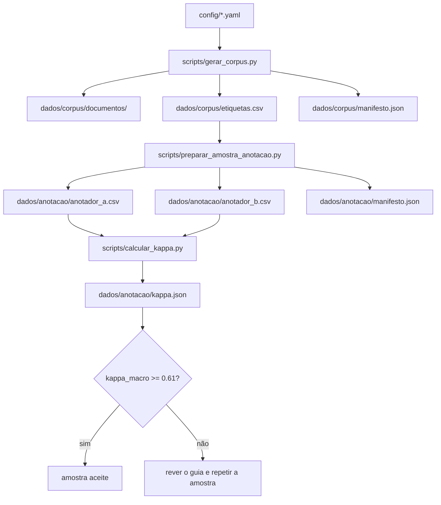
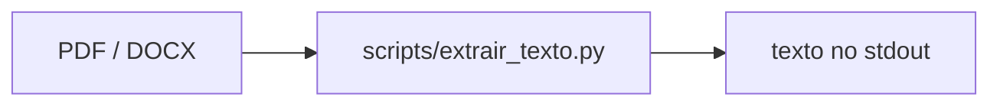
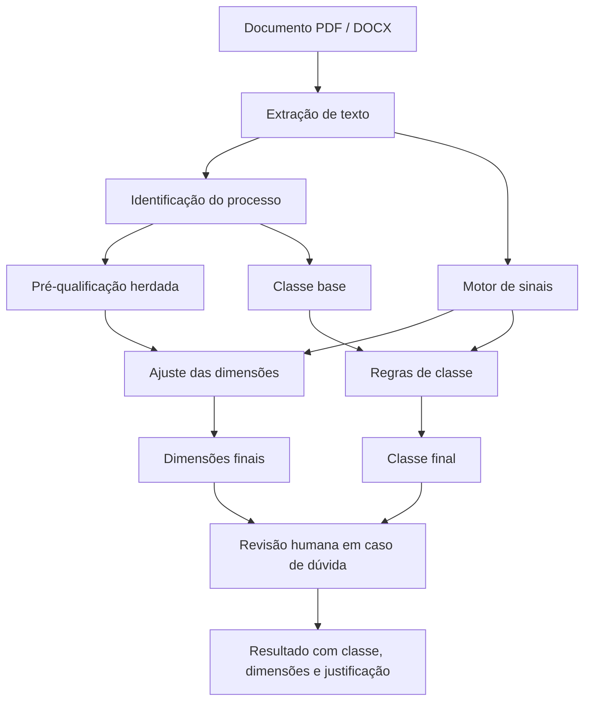

# Pipeline

O projeto tem duas coisas que podem ser chamadas de pipeline: o fluxo de dados que já está implementado e o fluxo de classificação que ainda falta construir. Convém separá-los para não dar a ideia de que o classificador já existe.

## Fluxo atual

Este é o fluxo que o código corre hoje. Começa na configuração, gera o corpus, prepara a amostra de anotação e termina no kappa.

A extração de texto está fora deste fluxo principal. É uma operação independente, usada para ler um documento isolado:

### Passos

| # | Passo | Comando | Entrada | Saída |
| --- | --- | --- | --- | --- |
| 1 | Extrair texto | `uv run python scripts/extrair_texto.py examples/0001100011.pdf` | PDF ou DOCX | Texto no terminal |
| 2 | Gerar corpus | `uv run python scripts/gerar_corpus.py --limpar` | `config/*.yaml` | Documentos, `etiquetas.csv`, `manifesto.json` |
| 3 | Preparar amostra | `uv run python scripts/preparar_amostra_anotacao.py --limpar` | `etiquetas.csv` | `anotador_a.csv`, `anotador_b.csv`, `manifesto.json` |
| 4 | Anotar | preencher os CSV à mão | Duas folhas independentes | As mesmas folhas preenchidas |
| 5 | Calcular kappa | `uv run python scripts/calcular_kappa.py` | As duas folhas preenchidas | `kappa.json` |

O passo 2 depende da configuração. O passo 3 depende do `etiquetas.csv`. O passo 5 depende das duas folhas estarem completas. Se faltar algum campo, o script termina com erro antes de calcular.

### Onde está o código

| Etapa | Módulo |
| --- | --- |
| Leitura dos YAML | `src/motor/config.py` |
| Extração de texto | `src/motor/extracao.py` |
| Geração do corpus | `src/motor/corpus.py` |
| Preparação da amostra | `src/motor/anotacao.py` |
| Cálculo do kappa | `src/motor/kappa.py` |
| Comandos de linha de comandos | `scripts/*.py` |

## Fluxo previsto da classificação

O motor de classificação ainda não está implementado. O que já está definido são as regras: extrair o texto, identificar o processo, herdar a pré-qualificação, detetar sinais no conteúdo, ajustar as dimensões e calcular a classe. As dúvidas vão para revisão humana.

O classificador baseline vai entrar depois do motor de sinais. O conjunto de teste, com 60 documentos, fica reservado para a avaliação e não deve ser usado para treinar nem para afinar regras.

### O que falta

| Componente | Estado |
| --- | --- |
| Extração de PDF e DOCX | Implementado |
| Geração do corpus sintético | Implementado |
| Amostra de dupla anotação | Implementado |
| Cálculo do kappa | Implementado |
| Motor de sinais | Por implementar |
| Classificador baseline | Por implementar |
| Avaliação no conjunto de teste | Por implementar |

O estado detalhado está no README. A arquitetura prevista, com as camadas de regras, ML e LLM, está em `docs/arquitetura.drawio`.
