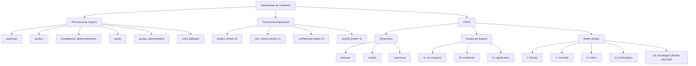
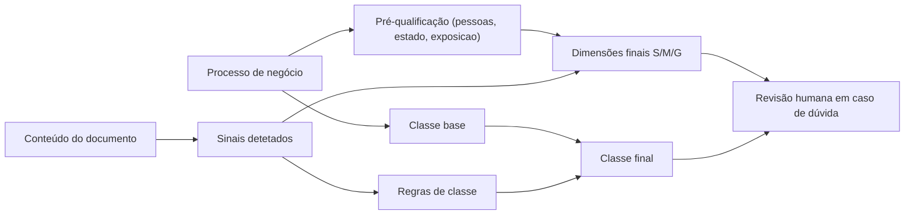

# Taxonomias

O projeto usa três taxonomias diferentes. Esta página junta as três num sítio só: os processos de negócio, a classificação empresarial e as dimensões do PNCS. Os dados vêm de `config/processos.yaml`, `config/taxonomia_empresa.yaml` e `config/taxonomia_pncs.yaml`.

## Visão geral

## Processos de negócio

São seis, incluindo o `outro`, que serve de fallback. O processo é a primeira coisa a identificar, porque as dimensões e a classe base dependem dele.

| id | nome | pessoas | estado | exposicao | classe base |
| --- | --- | --- | --- | --- | --- |
| `aquisicao` | Aquisição | S | M | M | `uso_interno` |
| `juridico` | Jurídico | S | M | M | `uso_interno` |
| `investigacao_desenvolvimento` | Investigação e Desenvolvimento | S | S | M | `uso_interno` |
| `saude` | Saúde | G | S | G | `confidencial` |
| `gestao_administrativa` | Gestão Administrativa | S | S | S | `uso_interno` |
| `outro` | Outro / Não identificado | S | S | S | `uso_interno` |

Nos cinco primeiros processos, as dimensões vêm da `pre_qualificacao_provisoria` de `processos.yaml`. O `outro` tem `pre_qualificacao_provisoria: null`, por isso usa os valores por omissão de `corpus.yaml` (`S`, `S`, `S`). A classe base também está em `corpus.yaml`, em `classe_base_por_processo`.

### Códigos CLAV

| processo | código | título oficial |
| --- | --- | --- |
| `aquisicao` | `300.10.005` | Transação e transmissão de bens móveis não culturais e contratação de serviços |
| `juridico` | `100.20.001` | Produção de pareceres técnico-jurídicos de interpretação de diplomas jurídico-normativos |
| `investigacao_desenvolvimento` | `800.20.002` | Execução de projetos de investigação aplicada |
| `investigacao_desenvolvimento` | `800.20.500` | Desenvolvimento experimental e aplicacional |
| `saude` | `700.20.200` | Prestação de cuidados de saúde personalizados |
| `saude` | `700.20.406` | Apoio ao diagnóstico e terapêutica |
| `gestao_administrativa` | `150.10.701` | Reunião de órgãos executivos |
| `gestao_administrativa` | `150.10.702` | Reunião de órgãos e estruturas operacionais e de aconselhamento |
| `outro` | nenhum | Categoria de fallback, sem códigos CLAV |

Os códigos foram conferidos em fontes públicas, mas todos têm a nota `confirmar_alteracoes_2026`. Não devem ser tratados como definitivos sem essa confirmação.

## Taxonomia empresarial

É uma política provisória da equipa, baseada no Guia do Aluno. Não é uma regra legal automática. A ordem das classes importa: a classe final é sempre a de maior ordem exigida pelos sinais e pelo contexto do processo.

| classe | ordem | descrição |
| --- | --- | --- |
| `publico` | 0 | Informação expressamente aprovada para divulgação pública e sem informação sensível não divulgável. |
| `uso_interno` | 1 | Informação operacional não destinada ao público, com impacto limitado se for divulgada. |
| `confidencial` | 2 | Informação pessoal, financeira, clínica ou comercial que exige acesso por necessidade de conhecer. |
| `restrito` | 3 | Informação especialmente crítica ou segredo de elevada sensibilidade, cuja exposição pode provocar dano elevado. |

### Regras preliminares

| sinal | efeito | classe |
| --- | --- | --- |
| `publicacao_autorizada` | Permite `publico` se não houver sinais impeditivos. | `publico` (condicional) |
| `iban` | Define uma classe mínima. | `confidencial` |
| `dados_clinicos` | Define uma classe mínima. | `confidencial` |
| `credenciais` | Define uma classe mínima. | `restrito` |
| `nif` | Obriga a revisão contextual. Por si só não força uma classe. | não força classe |

Em caso de empate, escolhe-se a classe de maior ordem. Se houver dúvida ou baixa confiança, o documento vai para revisão humana. Sem contexto, a classe inicial é `uso_interno`. O próprio ficheiro avisa que estes exemplos são políticas do projeto, não regras legais, e que `publico` exige uma indicação efetiva de divulgação.

## PNCS

O PNCS define três dimensões de impacto e uma escala de três valores. O algoritmo que transforma as dimensões nos níveis 0 a 3.b é provisório e não oficial. Vem do Guia do Aluno (página 3) e é assumido como hipótese didática.

### Dimensões

| id | nome | pergunta |
| --- | --- | --- |
| `pessoas` | Pessoas e vida humana | O comprometimento do processo, dados ou sistemas pode ameaçar a segurança ou vida de pessoas? |
| `estado` | Estabilidade do Estado | O comprometimento afeta a continuidade e estabilidade das funções do Estado ou serviços públicos? |
| `exposicao` | Exposição de dados | Quais os danos da divulgação indevida da informação suportada pelo processo? |

### Escala de impacto

| código | nome |
| --- | --- |
| `S` | Sem Impacto |
| `M` | Impacto Moderado |
| `G` | Impacto Significativo |

### Níveis oficiais

| código | nome |
| --- | --- |
| `0` | Neutro |
| `1` | Corrente |
| `2` | Crítico |
| `3.a` | Estratégico |
| `3.b` | Estratégico (âmbito nacional) |

### Regras do algoritmo provisório

| regra | condição | nível |
| --- | --- | --- |
| `todas_sem_impacto` | zero `G` e zero `M` | `0` |
| `algum_moderado_sem_significativo` | zero `G` e pelo menos um `M` | `1` |
| `um_significativo` | exatamente um `G` | `2` |
| `dois_ou_tres_significativos` | dois ou mais `G` | `3.a` |

O nível `3.b` não é inferido automaticamente. Só se aplica a partir de `3.a` quando existe controlo nacional explícito, e a nota do ficheiro pede uma lista definida e aprovação humana. Não se deve inferir controlo nacional a partir de palavras isoladas.

Duas regras importantes acompanham o algoritmo:

- A avaliação começa no processo de negócio, não apenas no documento. As avaliações ilustrativas de `processos.yaml` não substituem a futura pré-qualificação de processos CLAV de 2.º nível.
- A evidência concreta do documento pode subir cada dimensão (`S` < `M` < `G`), mas nunca descê-la abaixo do valor herdado do processo.

Em casos duvidosos, a decisão final é sempre de revisão humana.

## Como as taxonomias se combinam

O processo fornece a base; o conteúdo só ajusta para cima. A classe e as dimensões são calculadas em paralelo, a partir de fontes diferentes.

### Sinais e efeitos

| sinal | efeito nas dimensões | efeito na classe |
| --- | --- | --- |
| `nif` | sobe `exposicao` um nível | não força classe, exige revisão contextual |
| `iban` | sobe `exposicao` um nível | mínimo `confidencial` |
| `dados_clinicos` | `pessoas` e `exposicao` passam a `G` | mínimo `confidencial` |
| `credenciais` | `estado` e `exposicao` passam a `G` | mínimo `restrito` |
| `publicacao_autorizada` | sem efeito nas dimensões | permite `publico` apenas sem `iban`, `dados_clinicos` ou `credenciais` |

A geração do corpus já aplica estas regras. A aplicação das mesmas regras a documentos novos, que será a previsão do classificador, ainda não está implementada.
